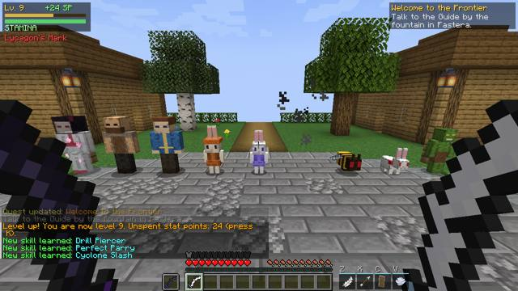
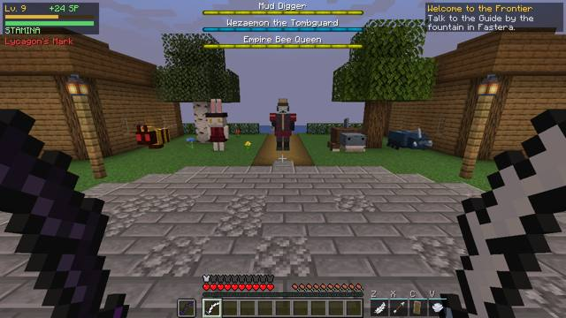
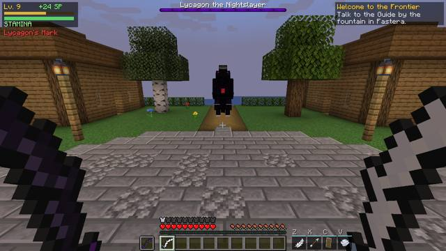
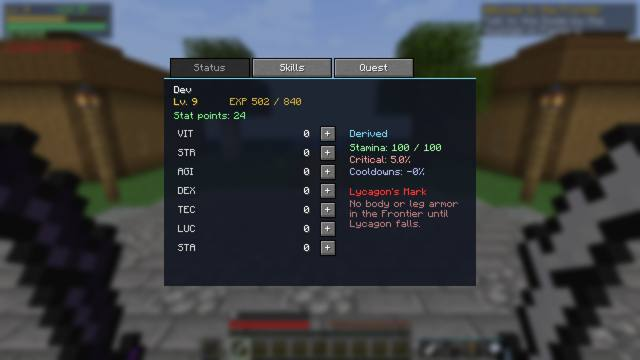
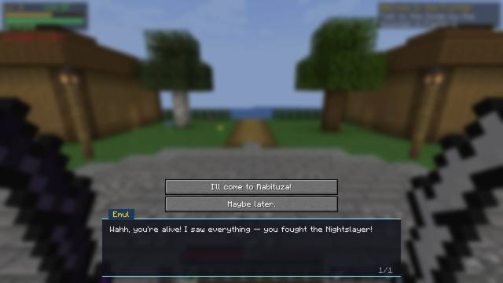

# Shangri-La Frontier — a Minecraft mod

A fan-made adventure mod inspired by the anime/manga **Shangri-La Frontier**
(story by Katarina, art by Ryosuke Fuji). Put on the **Full-Dive VR Headset**, log in
to *the Frontier* — a new dimension — and play through a story with levels, stats,
stamina, evolving skills, twin-blade combat, NPCs and the Unique Monsters.

> Not affiliated with or endorsed by the creators or publishers of Shangri-La Frontier.

| | |
|---|---|
| Minecraft | **1.21.1** |
| Loader | **NeoForge 21.1.x** (built against 21.1.264) |
| Java | 21 |
| Dependencies | none besides NeoForge |



| | |
|---|---|
|  |  |
|  |  |

*(Screenshots are taken automatically by CI on a headless client — see "Testing" below.)*

---

## Installing it with the CurseForge app

1. **Get the jar.** Either:
   * download it from this repo's **Actions** tab → latest *Shangri-La Frontier mod* run →
     **slfrontier-jar** artifact (unzip it), or
   * build it yourself (see *Building* below) — the jar ends up in `build/libs/`.
2. In the CurseForge app, open **Minecraft → Create Custom Profile**, pick
   **Minecraft 1.21.1** and the **NeoForge** loader (any 21.1.x version), and create it.
3. On the profile page click **⋯ → Open Folder**, open the `mods` folder, and drop
   `slfrontier-neoforge-1.21.1-<version>.jar` in it.
4. Hit **Play**.

(The mod is needed on both the client and the server.)

> When you open a world with the mod, Minecraft shows a one-time **"Worlds using
> Experimental Settings are not supported"** warning. That's vanilla's message for any
> world with a data-pack dimension (the Frontier). Click **"I know what I'm doing!"** —
> it won't show again for that world.

## Building

```bash
git clone https://github.com/camerondawkins0/mc_mods.git
cd mc_mods/shangri-la-frontier
./gradlew build          # Windows: gradlew.bat build
```

The first build downloads Minecraft and NeoForge (a few minutes). Other useful tasks:
`./gradlew runClient` launches a dev client with the mod, `./gradlew runServer` a dev
server.

---

## How to play

1. **Craft the Full-Dive VR Headset** (3 iron ingots / glass pane, block of redstone,
   glass pane / iron ingot, _, iron ingot) and **hold right-click** with it to log in.
   Use it again inside the Frontier to log out — you return to where you were, and you
   log back in where you left.
2. You arrive in **Fastera**, the starting town. Talk to the **Guide** by the fountain
   (right-click NPCs to talk).
3. Press **K** for the avatar menu (Status / Skills / Quest). Skill slots are on
   **Z X C V**. The **Frontier Compass** points to your current objective.

Your avatar's stats, stamina and skills only exist *inside* the Frontier — outside you're
just yourself.

### Story (main quest)

| Chapter | What happens |
|---|---|
| Welcome to the Frontier | Meet the Guide in Fastera; get the Mercenary Twin Blades and a compass. |
| First Blood | Defeat 5 Goblins on the plains. Reward: Sunraku's **Bird Mask**. |
| Ore for the Smith | Mine Gray Ore in the **Diremarsh Waste** for the Fastera Blacksmith → **Marsh Daggers**. |
| Whispers of the Night | Touch the altar in the **Nightslayer's Den** at night. **Lycagon the Nightslayer** appears… and you will lose. It leaves you at 1 HP with **Lycagon's Mark** (no body/leg armor in the Frontier). |
| Invitation from Rabituza | **Emul**, a Vorpal Bunny, finds you and invites you to **Rabituza**. |
| The Rabbit King | **Vysache** gives you the **Vorpal Choppers**, the **Vorpal Soul Collar** and the **Vorpal Bell** — Emul becomes your companion and casts *Magic Edge*. |
| Awakening the Vorpal Choppers | Bring a **Quad Beetle Shell** from the **Prismatic Forest Grotto** → the Moonblades **Waxing** and **Waning**, which can be joined into the **Twin Moon**. |
| A Garden of Red Lilies | Find **Setsuna of Distant Days** in the **Hidden Garden**. |
| Unique Scenario EX: The Tombguard | Defeat **Wezaemon the Tombguard**: parry his *Sky Clear* to disarm him, and drench him in **Holy Water** to quench his phase-3 aura. Reward: the **Seiten Skillbook** (*Sky Clear*). |
| The Night Must End | Learn *Crescent Vorpal* from Vysache, then slay Lycagon for real and lift the mark. |

Side content: **Bilac**'s forge in Rabituza (Ducusram, Empire Bee Twinblades,
Battlehorn Helm, Reallocation Tonic), the **Mud Digger** "Solo Killer" bounty, the
**Empire Bee Queen**, and loot in the **Iron Ruins of the Divinity**.

### Levels, stats and stamina

* EXP comes from defeating monsters in the Frontier (bosses give a lot). Level cap 99.
* Each level gives **3 stat points** (5 with the Vorpal Soul Collar, which costs 30% EXP).
* Stats: **VIT** health, **STR** damage, **AGI** speed, **DEX** attack speed,
  **TEC** cooldowns/parry window, **LUC** critical chance, **STA** stamina.
* Sprinting and skills use **stamina**; it refills when you stop.
* Dying in the Frontier sends you back to Fastera (or your Frontier bed) with a
  temporary **Death Penalty**. A **Rebirth Tearjewel** saves you once.

### Skills

| Skill | How to get it | Effect |
|---|---|---|
| Tap Step → **Slide Step** | Start / use 40× | Dash with invincibility frames (sneak = backstep). |
| Drill Piercer → **Glowing Pierce** | Lv 3 / use 30× | Lunging thrust; double damage on weak points (from behind). |
| Perfect Parry → **Repel Counter** | Lv 5 / 15 parries | Nullify an attack; evolved form counterattacks. |
| Cyclone Slash | Lv 8 | Spinning AoE. |
| Double Jump | Lv 10 | Passive: jump again in midair. |
| Rabbit Gun | Meet Vysache | With Emul: Magic Edge + launch at the target. |
| Moon Reflection | Moonblades | Crescent wave in front of you. |
| Crescent Vorpal | Vysache (final chapter) | Twin Moon leap-and-slam. |
| Sky Clear | Seiten Skillbook | Wezaemon's 360° cut. (It also clears the weather.) |

### Weapons

* **Twin blades** (Mercenary, Marsh Dagger, Ducusram, Vorpal Choppers, Empire Bee,
  Moonblades): hold one in each hand — every main-hand hit is followed by an off-hand strike.
* **Moonblades**: Waxing is +20% by day, Waning +20% by night. **Sneak + use** with both
  in hand to join them into the **Twin Moon** greatsword (hold use to charge a cleave;
  sneak + use with an empty off hand to split).
* **Tombguard Katana**: hold use to draw, release for an iaijutsu dash-cut.
* Attacks from behind hit weak points (+25%), and Luck gives critical hits.

### The Frontier dimension

Biomes: **Fastera Plains**, **Diremarsh Waste** (mud, gray ore), **Prismatic Forest
Grotto** (crystal pillars, Empire Bees, Quad Beetles), **Hidden Garden** (cherry trees and
red spider lilies), **Nightslayer Woods** (dark forest, shadow wolves at night) and the
**Frontier Sea**. Structures: Fastera, Rabituza (with the Vorpal Colosseum), Wezaemon's
Tomb, the Nightslayer's Den, the Empire Bee Hive, the Mud Digger's Lair and the Iron
Ruins of the Divinity.

### Commands

`/slf status` for everyone. Operators: `/slf level <player> <n>`, `/slf exp <player> <n>`,
`/slf quest <player> <stage>`, `/slf skill <player> <skill>`, `/slf curse <player> <bool>`,
`/slf login`, `/slf logout`, `/slf debug selftest`.

---

## For developers

```
src/main/java/com/slfrontier/
  data/         PlayerData attachment (level, stats, stamina, skills, quest, curse)
  skill/        Skill definitions and the server-side SkillExecutor
  quest/        Story + dialogue trees for every NPC
  entity/       FrontierMonster/FrontierBoss bases, mobs, bosses, NPCs, Holy Water
  item/ block/  Weapons, key items, the Nightslayer altar
  world/        Frontier keys, login/logout, town placement
  client/       HUD, menus, dialogue screen, models, renderers, keyframe animations
  mixin/        Player skill poses (HumanoidModel)
tools/
  models.py      creature geometry specs (single source of truth)
  gen_assets.py  -> ModelDefs.java + every texture (procedural pixel art)
  gen_data.py    -> lang, models, loot, recipes, tags, worldgen, structures (.nbt)
  ci_boot_test.py boots a real NeoForge server in CI and generates Frontier terrain
```

### Testing

Every push runs `.github/workflows/shangri-la-frontier.yml`, which:

1. builds the jar;
2. installs a real NeoForge server, boots it with the mod, generates Frontier terrain,
   locates every biome, places every structure and summons every boss and NPC;
3. runs `/slf debug selftest` and `/slf debug storytest` — the latter drives a fake
   player through every skill, every NPC dialogue at every quest stage, the compass and
   the boss rewards;
4. launches a real client on a virtual display, logs into the Frontier, lines up every
   creature, opens the menus and takes screenshots.

Art and structures are generated, so they can be rebuilt with
`python3 tools/gen_assets.py && python3 tools/gen_data.py` (needs Pillow). Replace any
PNG with hand-drawn art whenever you like — just don't re-run the generator afterwards
(or remove that item from it).

### References

Lore (names of places, monsters, items and skills) was checked against:
[Shangri-La Frontier Wiki — Seven Colossi](https://shangrila-frontier.fandom.com/wiki/Seven_Colossi),
[Wezaemon the Tombguard](https://shangrila-frontier.fandom.com/wiki/Wezaemon_the_Tombguard),
[Sunraku vs. Lycagon the Nightslayer](https://shangrila-frontier.fandom.com/wiki/Sunraku_vs._Lycagon_the_Nightslayer),
[Rakuro Hizutome/Skills](https://shangrila-frontier.fandom.com/wiki/Rakuro_Hizutome/Skills),
[Togetsu (Moonblades)](https://shangrila-frontier.fandom.com/wiki/Togetsu),
[Marsh Dagger](https://shangrila-frontier.fandom.com/wiki/Marsh_Dagger),
[Ducusram](https://shangrila-frontier.fandom.com/wiki/Ducusram),
[Mud Digger](https://shangrila-frontier.fandom.com/wiki/Mud_Digger),
[Diremarsh Waste](https://shangrila-frontier.fandom.com/wiki/Diremarsh_Waste),
[Quad Beetle](https://shangrila-frontier.fandom.com/wiki/Quad_Beetle),
[Emul](https://shangrila-frontier.fandom.com/wiki/Emul),
[Bilac](https://shangrila-frontier.fandom.com/wiki/Bilac),
[Seiten Skillbook](https://shangrila-frontier.fandom.com/wiki/Seiten_Skillbook),
[Episode 3](https://shangrila-frontier.fandom.com/wiki/Episode_3),
[List of episodes (Wikipedia)](https://en.wikipedia.org/wiki/List_of_Shangri-La_Frontier_episodes),
[TV Tropes character page](https://tvtropes.org/pmwiki/pmwiki.php/Characters/ShangriLaFrontier).
