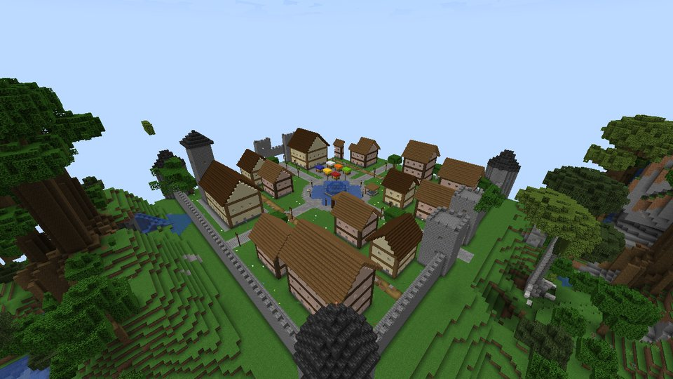
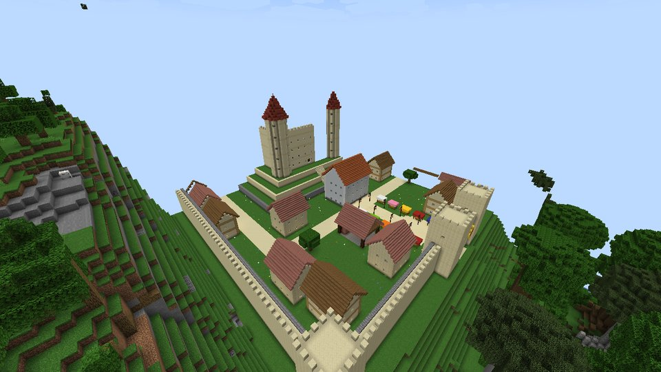
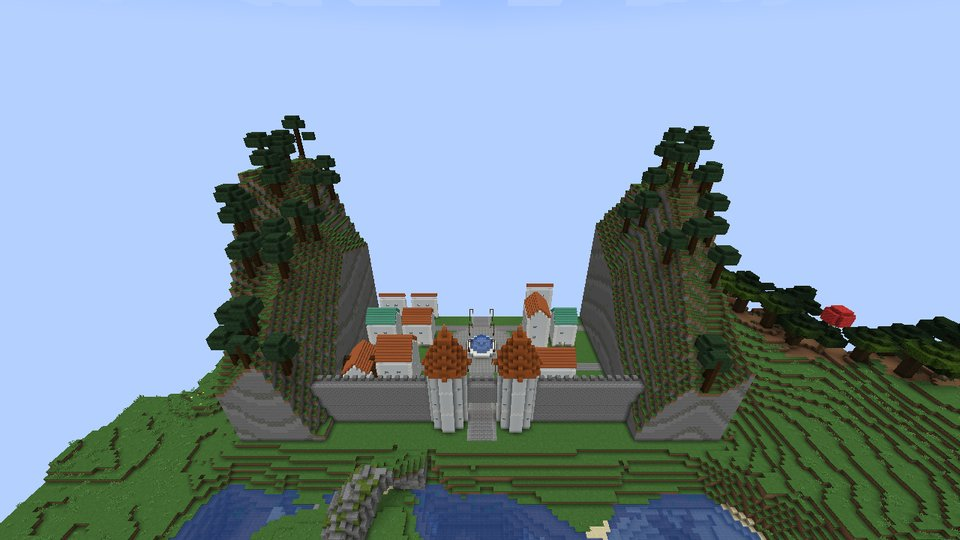
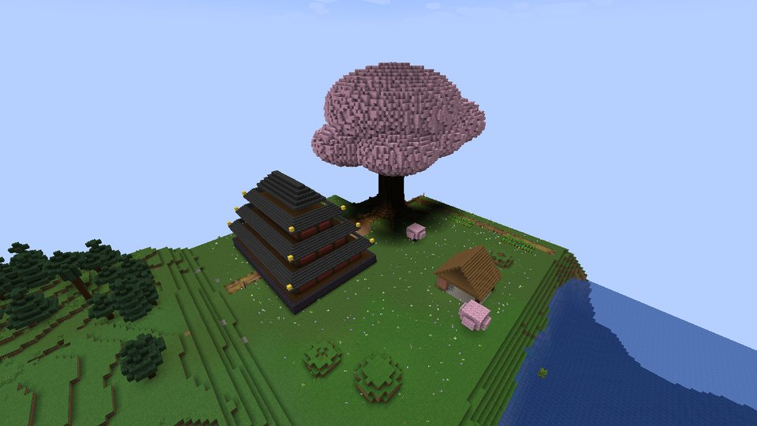
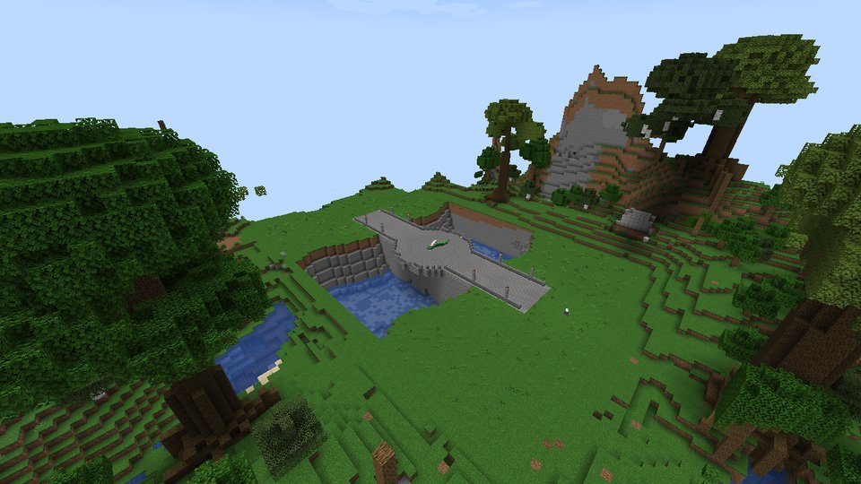
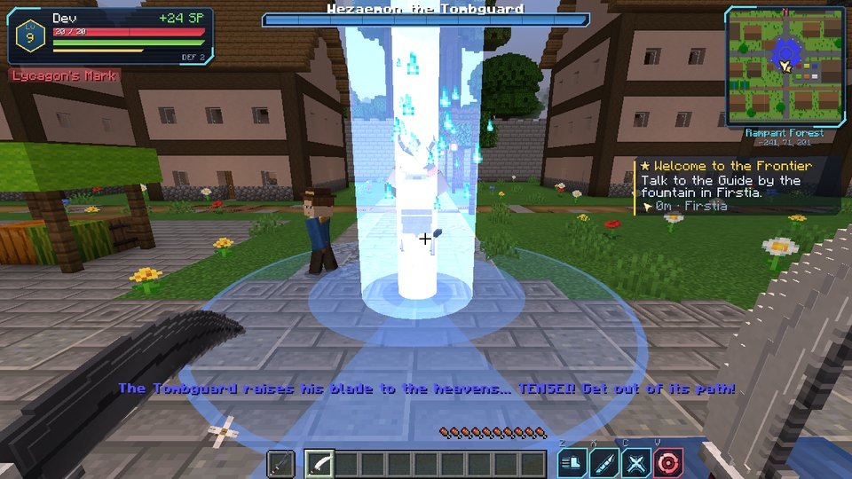
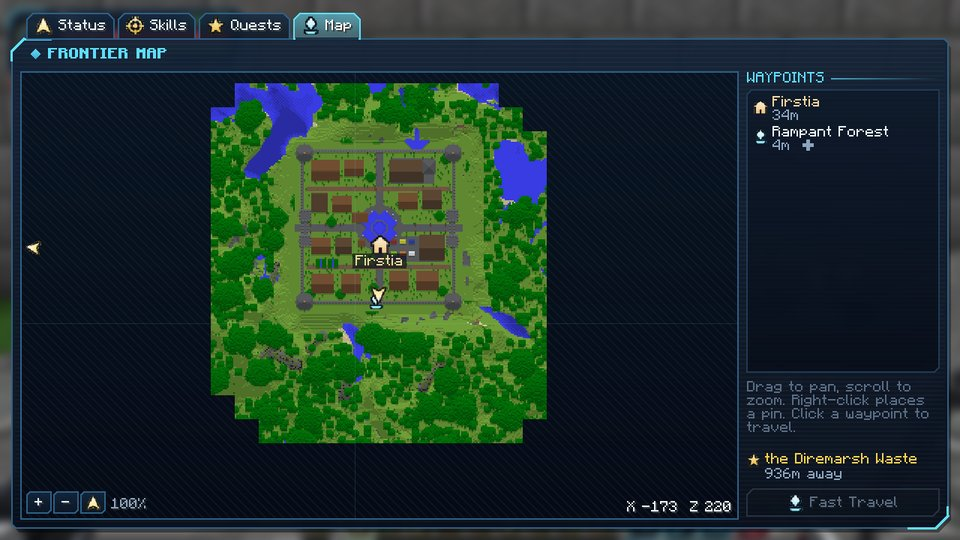
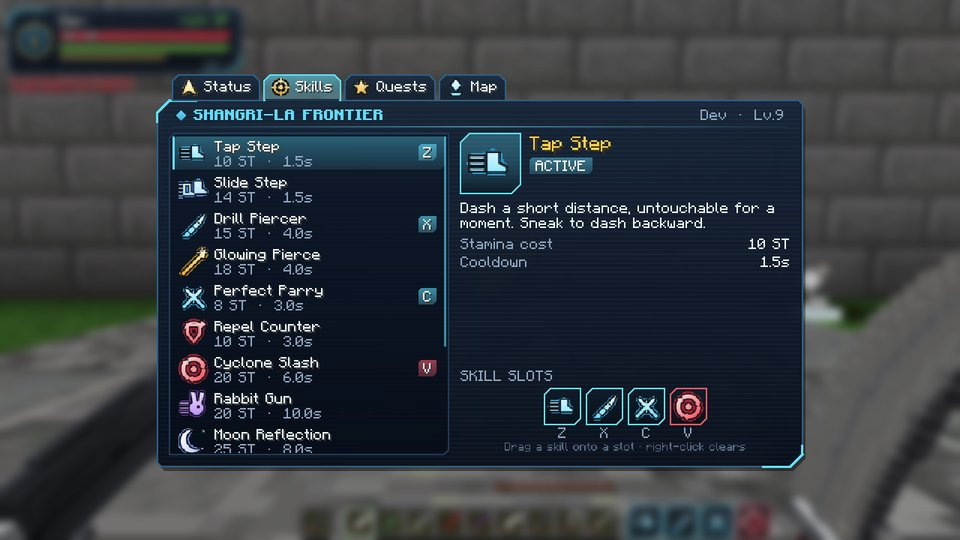
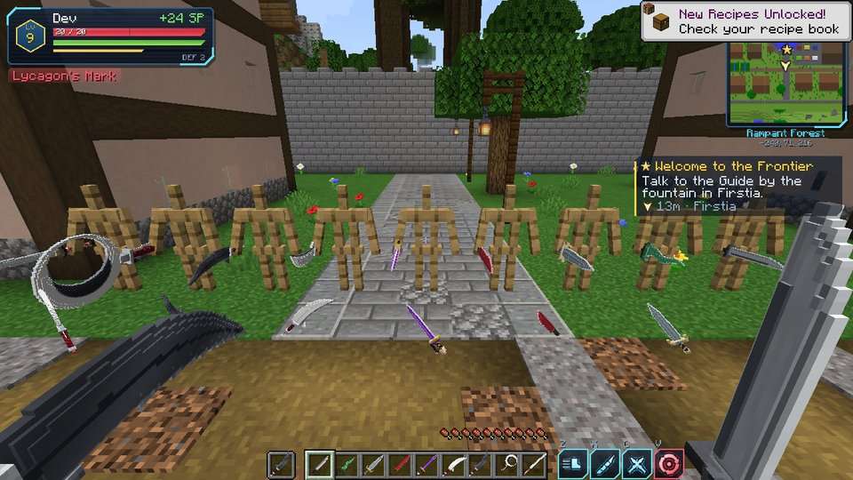
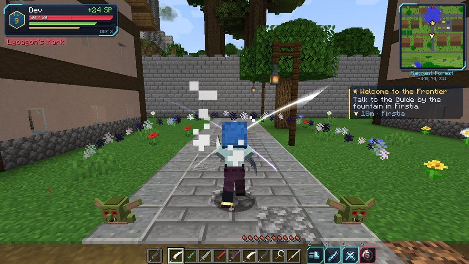

# Shangri-La Frontier — a Minecraft mod

A fan-made adventure mod inspired by the anime/manga **Shangri-La Frontier**
(story by Katarina, art by Ryosuke Fuji). Put on the **Full-Dive VR Headset**, log in
to *the Frontier* — a new dimension — and play through a story with levels, stats,
stamina, evolving skills, twin-blade combat, NPCs and the Unique Monsters.

> Not affiliated with or endorsed by the creators or publishers of Shangri-La Frontier.

| | |
|---|---|
| Minecraft | **1.21.1** |
| Loader | **NeoForge 21.1.x** (built against 21.1.264) |
| Java | 21 |
| Dependencies | none besides NeoForge |



| | |
|---|---|
|  |  |
|  |  |
|  |  |
|  |  |
|  |  |
|  |  |

*(Screenshots are taken automatically by CI on a headless client — see "Testing" below.)*

---

## Installing it with the CurseForge app

1. **Get the jar.** Either:
   * download it from this repo's **Actions** tab → latest *Shangri-La Frontier mod* run →
     **slfrontier-jar** artifact (unzip it), or
   * build it yourself (see *Building* below) — the jar ends up in `build/libs/`.
2. In the CurseForge app, open **Minecraft → Create Custom Profile**, pick
   **Minecraft 1.21.1** and the **NeoForge** loader (any 21.1.x version), and create it.
3. On the profile page click **⋯ → Open Folder**, open the `mods` folder, and drop
   `slfrontier-neoforge-1.21.1-<version>.jar` in it.
4. Hit **Play**.

(The mod is needed on both the client and the server.)

> When you open a world with the mod, Minecraft shows a one-time **"Worlds using
> Experimental Settings are not supported"** warning. That's vanilla's message for any
> world with a data-pack dimension (the Frontier). Click **"I know what I'm doing!"** —
> it won't show again for that world.

## Building

```bash
git clone https://github.com/camerondawkins0/mc_mods.git
cd mc_mods/shangri-la-frontier
./gradlew build          # Windows: gradlew.bat build
```

The first build downloads Minecraft and NeoForge (a few minutes). Other useful tasks:
`./gradlew runClient` launches a dev client with the mod, `./gradlew runServer` a dev
server.

---

## How to play

1. **Craft the Full-Dive VR Headset** (3 iron ingots / glass pane, block of redstone,
   glass pane / iron ingot, _, iron ingot) and **hold right-click** with it to log in.
   Use it again inside the Frontier to log out — you return to where you were, and you
   log back in where you left.
2. You arrive in **Firstia**, the walled starting town. Talk to the **Guide** by the
   fountain (right-click NPCs to talk).
3. **K** opens the avatar menu (Status / Skills / Quests / Map), **M** the map, **N**
   toggles the minimap. Skill slots are on **Z X C V**. The **Frontier Compass** and the
   quest tracker on the HUD point to your current objective.

Your avatar's stats, stamina and skills only exist *inside* the Frontier — outside you're
just yourself.

### Story (main quest)

The story follows Sunraku's road through the anime, in four acts.

| Act | Chapter | What happens |
|---|---|---|
| I | Welcome to the Frontier | Meet the Guide in Firstia; get the Mercenary Twin Blades and a compass. |
| I | First Blood | Defeat 5 Goblins. Reward: Sunraku's **Bird Mask**. |
| I | The Serpent at the Bridge | The road east through the **Rampant Forest** crosses a gorge on the **Serpent Bridge**. The **Ravenous Snake** — the area boss, white mane and all — rises from the river. |
| I | Outpost for Marsh Journeys | Cross into **Secondil** (tan walls, twin-towered gate, a castle on a hill) and meet its blacksmith. |
| I | Ore for the Smith | Mine Gray Ore in the **Diremarsh Waste** → **Marsh Daggers**. |
| II | Whispers of the Night | Touch the altar in the **Nightslayer's Den** at night. **Lycagon the Nightslayer** appears… and you will lose. It leaves you at 1 HP with **Lycagon's Mark** (no body/leg armor in the Frontier). |
| II | Invitation from Rabituza | **Emul**, a Vorpal Bunny, finds you and invites you to **Rabituza**. |
| II | The Rabbit King | **Vysache** gives you the **Vorpal Choppers**, the **Vorpal Soul Collar** and the **Vorpal Bell** — Emul becomes your companion and casts *Magic Edge*. |
| II | The Vorpal Colosseum | Win three rounds in Rabituza's arena: goblins, then Redcaps, then the **Aberrant Woodmage** (blades barely bite its wooden body — strike while it casts, or let Emul's magic burn it). |
| II | Awakening the Vorpal Choppers | Bring a **Quad Beetle Shell** from the **Prismatic Forest Grotto** → the Moonblades **Waxing** and **Waning** (Togetsu), which join into the **Twin Moon**. |
| III | The Solo Killer | Defeat the **Mud Digger** on the marsh road. Below 20% HP it dives, quakes the swamp and launches its prey. |
| III | The Big City | Reach **Thirdrema**, the white city in a cliff valley, and meet **Arthur Pencilgon** and **Oikatzo** at the *Serpent's Apple*. |
| III | A Garden of Red Lilies | Find **Setsuna of Distant Days** in the **Hidden Garden**, by the great dead tree. |
| III | Unique Scenario EX: The Tombguard | Fight **Wezaemon the Tombguard** with Pencilgon and Oikatzo at your side. He calls **Kirin**, his mech war-steed, in phase 2; parry *Sky Clear* to disarm him; drench him in **Holy Water** to quench his phase-3 aura; dodge *Tachikaze*, *Raisho* and *Tensei*. Reward: the **Seiten Skillbook** (*Sky Clear*). |
| IV | The Shadow of the Night | In the **Lightless Barrens**, wake the shadow altar and break **Lycagon's Shadow**, which rises from the dark, strikes once and sinks away. The mark becomes **Lycagon's Contusion**. |
| IV | The Night Must End | Learn *Crescent Vorpal* from Vysache, then slay Lycagon for real — it now vanishes into shadow and splits off clones — and lift the mark. |

**Side quests** are offered by NPCs (`[Quest]` options in dialogue) and tracked in the
Quests tab: Goblin Cull, Redcap Raiders, The Solo Killer bounty, Shell Collector, Long Live
the Queen, Giant Killer's Homework, Spirit Fist Sparring, Shadows of the Nightslayer, A
Garden for Two and Seasoned Adventurer. **Bilac**'s forge in Rabituza reforges Ducusram,
Empire Bee Twinblades, the Battlehorn Helm and Reallocation Tonics.

### Bosses

Every boss telegraphs its attacks with markings on the ground (circles fill up until the
hit lands; cones and lines show where a dash or a wave will go), so fights are about reading
and dodging — or parrying.

| Boss | Where | Highlights |
|---|---|---|
| Ravenous Snake | Serpent Bridge | Lunges, tail sweeps, slithering charges, poison sprayed from its tail hair. |
| Mud Digger | Diremarsh Waste | Burrows and erupts under you; the desperate quake. |
| Empire Bee Queen | Prismatic Forest Grotto | Sting dives, stinger barrages, calls her swarm. |
| Aberrant Woodmage | Vorpal Colosseum | Root spears under everyone, chain lashes, a grasping pull, blue bolts. |
| Wezaemon the Tombguard + Kirin | Hidden Garden | Iaijutsu, three-cut combos, Tachikaze, Raisho, Sky Clear, Tensei; Kirin's charge, missiles, laser sweep and lightning. |
| Lycagon's Shadow | Lightless Barrens | Surfaces from the dark for one attack at a time; faster on dark nights. |
| Lycagon the Nightslayer | Nightslayer's Den | Bites, claws, shadow dashes, howls, Night Rend, vanishing pounces and shadow clones. |

### Levels, stats and stamina

* EXP comes from defeating monsters in the Frontier (bosses give a lot). Level cap 99.
* Each level gives **3 stat points** (5 with the Vorpal Soul Collar, which costs 30% EXP).
* Stats: **VIT** health, **STR** damage, **AGI** speed, **DEX** attack speed,
  **TEC** cooldowns/parry window, **LUC** critical chance, **STA** stamina.
* Sprinting and skills use **stamina**; it refills when you stop.
* Dying in the Frontier sends you back to your last waypoint crystal (or Firstia) with a
  temporary **Death Penalty**. A **Rebirth Tearjewel** saves you once.

### Skills

| Skill | How to get it | Effect |
|---|---|---|
| Tap Step → **Slide Step** | Start / use 40× | Dash with invincibility frames (sneak = backstep). |
| Drill Piercer → **Glowing Pierce** | Lv 3 / use 30× | Lunging thrust; double damage on weak points (from behind). |
| Perfect Parry → **Repel Counter** | Lv 5 / 15 parries | Nullify an attack; evolved form counterattacks. |
| Cyclone Slash | Lv 8 | Spinning AoE. |
| Double Jump | Lv 10 | Passive: jump again in midair. |
| Rabbit Gun | Meet Vysache | With Emul: Magic Edge + launch at the target. |
| Moon Reflection | Moonblades | Crescent wave in front of you. |
| Crescent Vorpal | Vysache (final chapter) | Twin Moon leap-and-slam. |
| Sky Clear | Seiten Skillbook | Wezaemon's 360° cut. (It also clears the weather.) |

### Weapons

Every weapon is a full 3D model, designed after the anime:

* **Mercenary Twinblades** — plain single-edged steel short swords.
* **Marsh Daggers** — wavy kris blades of translucent green stone-glass with white crackle.
* **Ducusram** — Bilac's longer, double-edged reforge.
* **Vorpal Choppers** — long crimson knives with a wavy, jagged edge on dark wooden handles.
* **Empire Bee Twinblades** — a violet blade with a gold guard, a spiral black-and-gold grip and a knuckle-bow.
* **Moonblades (Togetsu)** — talon-curved crescents, pearl-white *Waxing* and gunmetal *Waning*,
  on maroon-corded grips with a red bead and a white hook charm.
* **Twin Moon** — the two locked into one huge crescent, white outside and black inside.
* **Tombguard Katana** — Wezaemon's long, slim blade with a red-corded hilt.

Twin blades: hold one in each hand — every main-hand hit is followed by an off-hand strike.
Waxing is +20% by day, Waning +20% by night; **sneak + use** with both in hand to join them
into the Twin Moon (hold use to charge a cleave; sneak + use with an empty off hand to
split). The katana: hold use to draw, release for an iaijutsu dash-cut. Attacks from behind
hit weak points (+25%), and Luck gives critical hits. Skills and big swings play keyframed
body animations (in first and third person) with slash arcs, shockwaves, spirals and
damage numbers.

### The Frontier

**Terrain** blends vanilla's shape with amplified mountains, and the land is dotted with
landmarks: colossal trees in the Rampant Forest, prismatic crystal spires in the Grotto,
natural stone arches, the tilted monoliths of the Divinity ruins and gnarled dead trees.

**Biomes:** Firstia Plains, the Rampant Forest, the Diremarsh Waste (mud, gray ore,
Redcaps at night), the Prismatic Forest Grotto, the Hidden Garden, the Nightslayer Woods,
the Thirdrema Highlands, the Lightless Barrens and the Frontier Sea.

**Towns and landmarks** are hand-built and placed on levelled, blended terraces the first
time anyone comes near:

* **Firstia** — walled, with slate-roofed towers, two gatehouses, a fountain plaza, an inn,
  a chapel, a guild hall and a market.
* **The Serpent Bridge** — a great arched bridge over a river gorge.
* **Secondil** — tan walls, a twin-towered west gate hung with red-and-gold banners, the white
  inn straight ahead, the smithy, market stalls and a castle on a terraced hill.
* **Thirdrema** — a stone city climbing a valley between two forested cliffs in three tiers,
  white houses with orange roofs, a white castle with orange spires and the *Serpent's Apple*.
* **Rabituza** — the hidden nation: a giant cherry-crowned tree, the red palace with its
  tiered roofs, the Vorpal Colosseum, rabbit burrows and carrot fields.

Dungeons: Wezaemon's Tomb, the Nightslayer's Den, the Empire Bee Hive, the Mud Digger's
Lair, the Iron Ruins of the Divinity and the Lightless Barrens' shadow altar.

### Map and fast travel

The **map** (M, or the Map tab) is drawn from the terrain you explore: pan, zoom toward the
cursor, drop pins (right-click), see towns, waypoints and your objective. Towns become
**waypoints** when you reach them, and every dungeon has a **Waypoint Crystal** to attune to.
Select a waypoint and press **Fast Travel** (not while in combat or near a boss; short
cooldown — configurable in the server config). You respawn at the last crystal you attuned.

### Commands

`/slf status` for everyone. Operators: `/slf level <player> <n>`, `/slf exp <player> <n>`,
`/slf quest <player> <stage>`, `/slf skill <player> <skill>`, `/slf curse <player> <bool>`,
`/slf login`, `/slf logout`, `/slf debug selftest`, `/slf debug storytest`.

---

## For developers

```
src/main/java/com/slfrontier/
  data/         PlayerData attachment (level, stats, stamina, skills, quests, waypoints)
  skill/        Skill definitions and the server-side SkillExecutor
  quest/        Story, dialogue trees, side quests, the Vorpal Colosseum trial
  entity/       FrontierMonster/FrontierBoss bases, mobs, bosses, NPCs and allies
  fx/           World-space effects the server sends to clients (arcs, rings, telegraphs, beams)
  item/ block/  Weapons, key items, altars, waypoint crystals
  world/        Frontier keys, login/logout, Landmarks (town planning + building), fast travel,
                map sync, worldgen features
  client/       HUD, menus, map, dialogue screen, models, renderers, animations, effects
  mixin/        Player animation hooks
tools/
  models.py      creature geometry and palettes  -> creatures.py paints textures + ModelDefs.java
  weapons.py     3D weapon models (silhouette extrusion, painted textures)
  icons.py       skill, stat and UI icons
  townkit.py     building blocks (walls, towers, roofs, houses...) used by towns.py
  towns.py       Firstia, Secondil, Thirdrema, Rabituza and the Serpent Bridge
  structures.py  dungeons; writes every template (.nbt)
  gen_assets.py  -> every texture and model     gen_data.py -> lang, loot, tags, worldgen
  preview.py     quick software renders: `items`, `mobs`, `structure <name>`
  ci_boot_test.py boots a real NeoForge server in CI and exercises everything
```

### Testing

Every push runs `.github/workflows/shangri-la-frontier.yml`, which:

1. builds the jar;
2. installs a real NeoForge server, boots it with the mod, generates Frontier terrain,
   locates every biome, places every structure and template and summons every creature;
3. runs `/slf debug selftest` and `/slf debug storytest` — the latter drives a fake
   player through every skill, every NPC dialogue at every quest stage, the compass, every
   chapter's story hook, builds every landmark, triggers the Serpent Bridge ambush and runs
   every boss's whole moveset once;
4. launches a real client on a virtual display, logs into the Frontier, lines up every
   creature, triggers boss attacks, shows the weapons, skills and menus, flies over each
   town and takes screenshots. Locally, `./gradlew runClientTest -PslfScenes=world,bosses`
   runs a subset of scenes.

Art, models and structures are generated, so they can be rebuilt with
`python3 tools/gen_assets.py && python3 tools/gen_data.py` (needs Pillow). Replace any
PNG with hand-drawn art whenever you like — just don't re-run the generator afterwards
(or remove that item from it).

### References

Lore (names of places, monsters, items and skills) was checked against:
[Shangri-La Frontier Wiki — Seven Colossi](https://shangrila-frontier.fandom.com/wiki/Seven_Colossi),
[Wezaemon the Tombguard](https://shangrila-frontier.fandom.com/wiki/Wezaemon_the_Tombguard),
[Sunraku vs. Lycagon the Nightslayer](https://shangrila-frontier.fandom.com/wiki/Sunraku_vs._Lycagon_the_Nightslayer),
[Rakuro Hizutome/Skills](https://shangrila-frontier.fandom.com/wiki/Rakuro_Hizutome/Skills),
[Togetsu (Moonblades)](https://shangrila-frontier.fandom.com/wiki/Togetsu),
[Marsh Dagger](https://shangrila-frontier.fandom.com/wiki/Marsh_Dagger),
[Ducusram](https://shangrila-frontier.fandom.com/wiki/Ducusram),
[Mud Digger](https://shangrila-frontier.fandom.com/wiki/Mud_Digger),
[Diremarsh Waste](https://shangrila-frontier.fandom.com/wiki/Diremarsh_Waste),
[Quad Beetle](https://shangrila-frontier.fandom.com/wiki/Quad_Beetle),
[Emul](https://shangrila-frontier.fandom.com/wiki/Emul),
[Bilac](https://shangrila-frontier.fandom.com/wiki/Bilac),
[Seiten Skillbook](https://shangrila-frontier.fandom.com/wiki/Seiten_Skillbook),
[Episode 3](https://shangrila-frontier.fandom.com/wiki/Episode_3),
[List of episodes (Wikipedia)](https://en.wikipedia.org/wiki/List_of_Shangri-La_Frontier_episodes),
[TV Tropes character page](https://tvtropes.org/pmwiki/pmwiki.php/Characters/ShangriLaFrontier).
